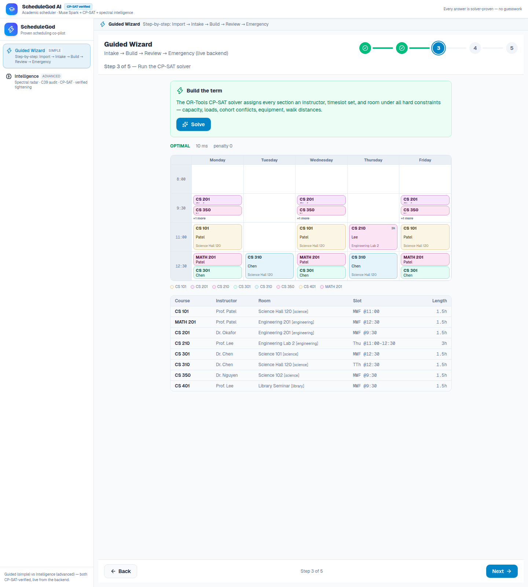
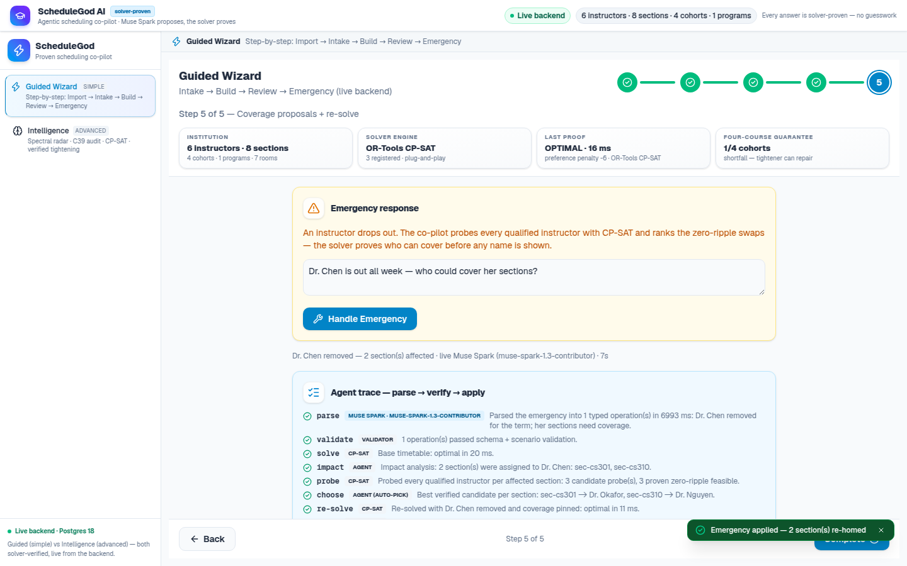
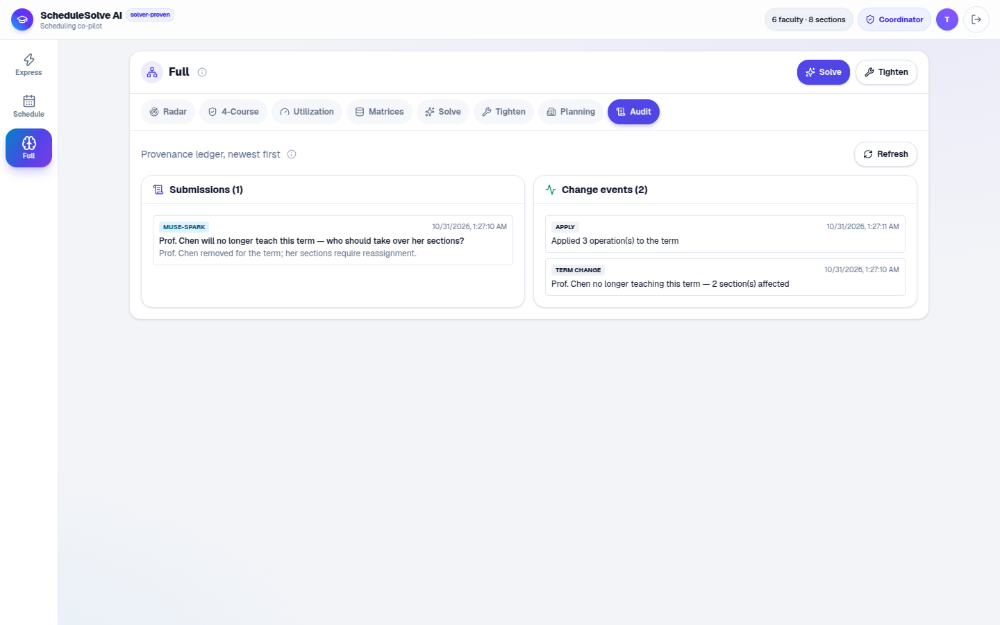

[](https://github.com/prohle/schedulegod-ai/actions/workflows/ci.yml)
[](./LICENSE)
[](./backend)
[](./frontend)
[](#run-it)
[](./docker-compose.yml)

# ScheduleGod AI — Agentic Constraint Solver & Timetable Infrastructure

> **Category:** Autonomous Agents & Workflows · Education & Knowledge Systems
> **Domain:** Combinatorial optimization, operations research, constraint programming (CP-SAT), spectral graph analysis
> **Stack:** Meta Model API (Muse Spark) · **dual solver engines — OR-Tools CP-SAT and an AI-built, from-scratch pure-Python solver you can choose instead, then compare side by side** · FastAPI · Next.js · Postgres 18

**Every term, every department rediscovers that the course timetable is an NP-hard constraint problem managed with email and spreadsheets.**

A department's instructors — twenty-six in the loadable department-scale scenario, six in the demo seed — with hard constraints ("never Tuesdays, committee duty"), soft preferences ("mornings, please"), teaching-load and prep caps. Four cohorts at different points of the same degree roadmap — the CS 2025 cohort needs CS 201 *this term* or forty-five students slip a semester. Elective pools with estimated take-up, enrollment that surges after registration closes. A fixed inventory of rooms — each course needing the right equipment and size — across a campus you can't cross in ten minutes between classes. And one coordinator whose calendar bleeds a week, every term, translating all of it into a spreadsheet that is wrong the moment reality changes.

**ScheduleGod AI is the agentic co-pilot for that week.** Messy files go in — in any format, from any office — Muse Spark autocleans them into one model of the entire institution, natural language adds constraints, and a deterministic solver engine guarantees the output: a provably feasible, recommended timetable for the whole college/university, a minimal-conflict explanation when a request can't hold, and when reality breaks the term mid-flight (an instructor drops out, a hall closes), the co-pilot doesn't guess who can cover. **It proves it.**

> The LLM never touches the schedule. It only proposes constraints, and every
> constraint — and every coverage proposal — is verified by a solver.

Built for the **Meta Global AI Developer Hackathon** — *Build for Your World* track. This is the problem we know firsthand.





## How it works

```
INGEST     point the tool at messy institutional files in ANY format — a PDF
           catalog, a Word degree map, a CSV of cohorts, an Excel room sheet,
           plain-text emails, or a zip of all of them. A format layer extracts
           the text (PDF/DOCX/XLSX/CSV/JSON/TXT/MD/ZIP); if the files answer
           the six requirements, Muse Spark autocleans them into typed
           entities and the normalizer assembles the Scenario — one model of
           the entire college/university
INTAKE     the coordinator pastes or drops the term's intake (v1: one
           intake box + a speaker picker; per-instructor windows with
           deadlines are the next step): free-text constraints -> Muse Spark
           (structured output) -> typed hard/soft constraints -> validated
           -> provenance stored
BUILD      CP-SAT assigns every section an instructor, timeslot set, and room:
           qualification, loads, prep caps, room capacity/type, equipment,
           meeting patterns, cohort conflicts, electives, campus walk
           distances, active enrollment, preferences
OPERATE    an emergency arrives (a typed message):
           impact analysis ->
           propose_candidates: every qualified instructor CP-SAT-probed for
           zero-ripple feasibility + preference delta, ranked with plain-English
           reasons -> pick -> timetable morphs
TIGHTEN    when the solver deadlocks or the four-course guarantee fails:
           spectral radar -> Muse Spark proposes typed repair moves
           (raise_load_cap, add_section, add_qualification, open_elective,
           drop_request) -> CP-SAT verifies each -> only proven moves shown
```

When a request set is infeasible, the solver doesn't just fail — every incoming constraint is guarded by a CP-SAT *assumption literal*, so the model returns the **minimal conflicting subset** of the request. Then the two-layer self-heal fires: **Muse Spark translates the proof** (plain-English explanation + ranked resolutions, each dropping one conflicting request), and **CP-SAT re-solves every proposed resolution** before it can be shown — the agent presents only *proven* options, and auto-applies the least disruptive one.

**Every co-pilot run returns an agent trace** — the autonomous loop made visible, step by step with the actor named: `parse (Muse Spark) → validate → solve (CP-SAT) → conflict-core → explain (Muse Spark) → verify each resolution (CP-SAT) → auto-apply the least-disruptive proven fix → audit`. The Emergency flow traces the same way (`transcribe → parse → impact → probe every candidate → choose → re-solve → audit`). The wizard renders the trace live; it is also in the API response (`agent_trace`). No step is a model guess: each one either proposes (Muse) or proves (CP-SAT).

**Spectral warm-start runs on every solve**: the section-conflict graph (cohort hard edges + instructor soft edges) yields Laplacian eigenvalues and the Fiedler vector, whose spectral coloring becomes CP-SAT `AddHint` hints. The same graph powers a **deadlock radar** — algebraic connectivity μ₂, Hoffman chromatic lower bound, exact max clique — that names a structural deadlock (a same-pattern clique exceeding the 4-period MWF/TTh band) *before* the solver wastes a solve, and feeds the tightener.

**Four-course guarantee (C39)** audits every placed timetable: can each cohort assemble ≥4 distinct, mutually non-overlapping courses toward graduation? Shortfalls trigger the tightener's `open_elective` moves, which the solver verifies.

Full constraint catalog — offerings & degree roadmaps, course optionality, active enrollment, equipment, cohort progression, instructor hard/soft schedules, rooms & campus walk matrix, with a coverage map of every real-world consideration: [docs/constraint_catalog.md](./docs/constraint_catalog.md)

## What a demo sounds like

| Who says | What happens |
|---|---|
| "Prof. Patel can't teach Mondays — committee duty." | Her sections legally re-home to other instructors and the rest of the board shifts to keep the cohort conflict-free. One sentence, a multi-section ripple, all solver-verified — and **applied to the term**, so the next solve keeps it. |
| "Dr. Chen is out all week — who could cover her sections?" | Two affected sections. Ranked, CP-SAT-verified coverage proposals — *Okafor (qualified, load 2/3, no preference cost)* over *Nguyen (qualified, +8 preference penalty)* — chosen, re-solved. |
| "Diaz is taking over CS 101, MATH 201 and CS 201 personally." | INFEASIBLE — Diaz's load cap is two sections. Muse Spark's explanation names the binding rule and ranks resolutions ("drop the CS 201 pin — Okafor has capacity to take it"); **every option is re-solved by CP-SAT with its own penalty delta**, the least disruptive one applies. |
| "CS 350 enrollment jumped to 45 after registration ended." | Active enrollment re-triggers every capacity check; the board re-solves and CS 350 lands in the 120-seat hall with zero cohort conflicts. |
| *(C39 shortfall fires)* | "CS 2023 cohort can only fit 2 of 4 non-conflicting courses." → the tightener proposes opening already-offered electives; CP-SAT verifies the margin gains against the current board and **rejects** moves that make the enlarged scenario infeasible. Only verified moves are shown. |

## Proof at university scale

The demo story above is one department slice (6 instructors, 8 sections) so every beat fits in three minutes. The same engine — same code path, one click in the Build step (**Load department scale** / **Load university scale**, or `POST /scenario/department` / `/scenario/university`) — solves a full department cluster (**26 instructors, 25 sections, 12 cohorts, 3 programs**) or the entire university (**38 instructors, 41 sections, 20 cohorts, 5 programs** sharing the same rooms, slots, and campus walk matrix), built deterministically from the seed (`backend/app/data/department.py`). Measured with `backend/scripts/benchmark.py` (single-worker deterministic CP-SAT, dev laptop):

| Scenario | Instructors | Sections | Rooms | Cohorts | Programs | CP-SAT | Ours (home solver) | C39 guarantee | Room util. | Emergency (Chen out) |
|---|---:|---:|---:|---:|---:|---|---|---|---:|---|
| Story seed (demo) | 6 | 8 | 7 | 4 | 1 | optimal ~70 ms · penalty −6 | optimal ~45 ms · penalty −6 | 2/4 (tightener demo world) | 39% | 2 affected, 3/3 probes feasible |
| Department scale | 26 | 25 | 16 | 12 | 3 | optimal ~140 ms · penalty −40 | feasible ~5 s · penalty −40 | 12/12 cohorts ≥ 4 courses | 52% | 2 affected, 3/3 probes feasible, re-solve optimal |
| University scale | 38 | 41 | 16 | 20 | 5 | **optimal ~260 ms · penalty −40** | feasible ~5 s · penalty −40 | **20/20 cohorts ≥ 4 courses** | 64% | 2 affected, 3/3 probes feasible, re-solve optimal |

## Two engines, one contract: industrial CP-SAT vs an AI-crafted solver

**We used AI to build a second solver, not just to call one.** Alongside Google's engine, ScheduleGod ships a complete constraint solver designed and written for this problem — and because both live behind one standardized interface (`GET /engines`, `POST /solve` with `engine`, one `SolveResult` shape), you can choose either per solve, or race them head-to-head on the *exact* same messy constraints, preferences, and room capacities. That split-screen contrast is the trust story: two independent implementations cross-checking each other, live.

- **OR-Tools CP-SAT** (`cpsat`): industrial brute force done right — C++, clause learning, cuts through the search space and returns a *mathematically proven* optimum in fractions of a second. Assumption literals give minimal conflict cores.
- **ScheduleGod home solver** (`ours`, `backend/app/solver/home_solver.py`): custom heuristic intelligence, built with AI assistance around this domain's trade-offs — MRV ordering over live domains, forward checking, least-penalty value ordering with spectral-hint tie-breaks, branch-and-bound with an admissible bound, then a hill-climbing phase (single-section + ejection moves) that balances soft preferences the way a human coordinator would, and deletion-minimization conflict cores with itself as oracle. No OR-Tools anywhere in its path.
- **Greedy descent** (`greedy`): the home solver's first pass only — plug-and-play proof that a new engine is one registry entry (`backend/app/solver/engine.py`); it shows exactly what the optimization phases buy.

**Head-to-head (measured, `scripts/benchmark.py`):** on the seed, ours is *faster* than CP-SAT and proves the same optimum (−6). At department and university scale it reaches CP-SAT's optimal penalty (−40) inside its 5 s budget; CP-SAT additionally *proves* optimality in ~0.15–0.3 s — the honest difference is proof speed at scale, and the UI says so instead of hiding it. **Compare side by side** (Build step, or `POST /solve/compare`) diffs status, runtime, penalty delta, placement-agreement %, and both grids with differing sections ringed. When two engines built completely differently agree, you can trust the timetable; when they disagree, the diff shows exactly where and by how much. Tests verify ours independently — hard constraints checked from placements alone, objective parity, the identical conflict core `[0,1,2]` on the Diaz overload, determinism (`backend/tests/test_home_solver.py`, `tests/test_extract.py` for the format layer).

At department scale every cohort still gets its four-course guarantee, every course has ≥2 qualified instructors, and the Chen emergency still re-homes exactly CS 301 + CS 310 with zero ripple. Locked in by `backend/tests/test_department.py`. Reproduce: `cd backend && .venv/bin/python scripts/benchmark.py`.

**Capacity showcase (university scale, one click in Build):** 5 degree programs (CS, Mathematics, Data Science, Business, Humanities) · 38 instructors · 41 sections · 20 cohorts · **530 students** on degree roadmaps · 16 rooms / 694 seats / 4 buildings with a walk-time matrix · 20 weekly slots per room — all of it solved as *one* institution sharing the same rooms and hours, not five toy departments side by side. That is the capacity a real registrar's office actually schedules.

**Coordinator-time impact:** the manual baseline this replaces is roughly a coordinator-week per term (~30–40 hours of email, spreadsheets, and rework, plus hours per mid-term disruption). ScheduleGod AI's measured loop is: one Muse parse (~8–25 s live), one CP-SAT solve (~0.15 s at department scale), and — per disruption — a probe-verified coverage decision in seconds. The honest claim is not "AI schedules for you"; it is that a week of constraint-wrangling compresses into an auditable review of solver-proven options.

## Meta AI tooling at runtime

**Every model this project calls at runtime is a Meta model**, via the Meta Model API. The deterministic core (OR-Tools CP-SAT) is not a model — the LLM proposes, the solver proves. When no API key is present, all model roles degrade to deterministic templates (dev/tests cost zero credits).

| # | Runtime call | Model | Code | When it fires |
|---|---|---|---|---|
| 1 | Data ingestion → autoclean free-form institutional data into the structured scenario (structured output) | Muse Spark `muse-spark-1.3-contributor` | `backend/app/ingestion/parser.py` | you paste a catalog / degree maps / cohorts / faculty / rooms |
| 2 | Constraint parsing → typed operations (structured output) | Muse Spark `muse-spark-1.3-contributor` | `backend/app/parsing/parser.py` | every intake submission, chair request, emergency message |
| 3 | Self-healing explanation → conflict explanation + ranked resolutions (structured output) | Muse Spark `muse-spark-1.3-contributor` | `backend/app/agent/explainer.py` | whenever a solver proves a request infeasible |
| 4 | Intelligence tightening → typed repair moves (structured output) | Muse Spark `muse-spark-1.3-contributor` | `backend/app/intelligence/tightener.py` | spectral deadlock warning, C39 margin shortfall, or base infeasibility |

**Set your key** (the repo ships `.env.example` — copy it to `.env` and fill in `MODEL_API_KEY`; `.env` is gitignored):

```bash
cp .env.example .env        # then paste your key from https://dev.meta.ai/dashboard
docker compose up --build   # live Muse Spark
```

**Sample outputs / provenance:** `backend/muse-verification.json` is a live captured run of all four structured roles against the seed (ingestion + parse + explanation + tighten), all `muse-spark-1.3-contributor`, with real structured outputs and latencies (8–25 s per call). The parse battery includes a speaker context for identity-dependent messages.

*All four structured roles run on the contributor model because the data is synthetic; a real institution would use standard mode (`muse-spark-1.3`) so no staff data ever trains Meta's models. Dev-time coding tools are unrestricted by the hackathon and touch nothing at runtime.*

**Open-weights path — verified live:** the client is endpoint-agnostic (`MUSE_BASE_URL` + `MUSE_MODEL`), and all four structured roles are verified running on **Muse Spark Open** (`meta-models/muse-spark-open-1026`) served by Baseten: `backend/muse-verification-open.json` captures 18/18 live calls (12 parse, 3 explanation, 2 tighten, 1 ingestion) with real structured outputs and latencies. To run the whole app on open weights, set `MUSE_BASE_URL=https://inference.baseten.co/v1`, `MUSE_MODEL=meta-models/muse-spark-open-1026`, and the Baseten key as `MODEL_API_KEY` — no code changes.

## Intelligence layer (scipy sparse + spectral + AI)

| Endpoint | What it returns |
|---|---|
| `GET /intelligence/matrices` | 8 labeled sparse matrices (scipy CSR): classroom (rooms×courses, seat headroom), fulfilment (cohorts×courses, depth-before-completion), demand, cohort_sections, faculty_availability (instructors×20 slots), faculty_blackouts, faculty_preferences, qualification. Departmental capacity heatmap + dead zones from stacking the faculty tensor. |
| `GET /intelligence/spectral` | Conflict-graph spectrum: Laplacian eigenvalues, algebraic connectivity μ₂, Hoffman chromatic lower bound, exact max clique (Bron-Kerbosch), Fiedler vector + 2-way partition, spectral ordering → **slot hints injected into CP-SAT as AddHint warm-start**. Deadlock warnings (structural infeasibility, clique > band capacity). |
| `GET /intelligence/margins` | C39 four-course guarantee audit against the placed timetable: per-cohort max non-overlapping course count, example track, offered pool, risk flag. |
| `POST /intelligence/tighten` | Muse proposes typed moves from closed grammar; CP-SAT re-solves each mutated scenario. Only *verified* moves returned, with their penalty deltas and new margins. |
| `GET /history` | The provenance ledger: every intake submission and change event (`parse` / `apply` / `drop` / `emergency` / `tighten`), surfaced in the **Audit Trail** tab. |

### Screens

**Audit trail** — every submission and change event, newest first, with the live `muse-spark` badge.



## Stack

- **Backend:** Python / FastAPI, OR-Tools CP-SAT (assumption literals for minimal-conflict explanation, feasibility probes for coverage proposals, `AddHint` for spectral warm-start) **plus a from-scratch pure-Python home solver** (`backend/app/solver/home_solver.py`), selectable per solve and comparable side by side
- **Frontend:** Next.js
- **Intelligence:** `scipy.sparse` CSR matrices, `numpy`/`scipy` spectral graph (Laplacian, Fiedler, Hoffman bound, exact max clique)
- **Inference:** Meta Model API (OpenAI-compatible, `beta.chat.completions.parse` structured output) — deterministic mock parser included so dev/tests burn zero credits
- **Persistence:** SQLAlchemy over **Postgres 18** (Docker) or **SQLite** (no-Docker fallback) — constraint provenance + the self-healing audit trail (`/history`)
- **Deploy:** `docker compose up` (db + backend + frontend) or `./start.sh` for a no-Docker local run; public demo via Modal (backend) + Vercel (UI)

## Run it

**Judges — try it in 2 minutes, no account, no API key:**

```bash
git clone https://github.com/prohle/schedulegod-ai && cd schedulegod-ai
docker compose up --build
# open http://localhost:3000 — Import → Intake → Build → Review → Emergency
```

Without a key the model roles degrade to a deterministic mock parser, so every beat (parse → solve → self-heal → emergency coverage → department scale) is clickable offline at zero cost. Add `MODEL_API_KEY` (see below) and the same clicks run live Muse Spark with on-screen model + latency badges. Submission details, track, and bonus-prize flags: [docs/submission.md](./docs/submission.md).

**Hosted demo:** the backend is Modal-ready ([docs/deploy_modal.md](./docs/deploy_modal.md)) and the UI deploys to Vercel; set `BACKEND_URL` to the Modal URL. The local one-command path is below.

**Full stack (one command):**

```bash
docker compose up --build
# frontend http://localhost:3000 · backend http://localhost:8000/docs · db postgres:5432
# taken ports?  BACKEND_PORT=8011 FRONTEND_PORT=3011 docker compose up --build
# live Muse?    MODEL_API_KEY=... docker compose up --build
```

**No Docker (local dev):**

```bash
./start.sh        # bootstraps venv + node_modules, auto-picks free ports, Ctrl-C stops both
```

**Backend only:**

```bash
cd backend
python -m venv .venv && .venv/bin/pip install -r requirements.txt
.venv/bin/python demo.py            # full pipeline, mock parser, zero credits
.venv/bin/uvicorn app.main:app      # API at http://localhost:8000/docs
```

Set `MODEL_API_KEY` (from the [Meta Model API dashboard](https://dev.meta.ai)) to switch parsing from mock to live Muse Spark.

**Tests:**

```bash
cd backend
.venv/bin/pip install -r requirements.txt -r requirements-dev.txt
.venv/bin/python -m pytest -q
```

The suite covers solve determinism, hard-constraint satisfaction, the
minimal-conflict core, durable applied state (`/apply` then `/solve`), emergency
coverage, the spectral graph, and the API contract. GitHub Actions runs the
backend suite and a production frontend build on every push.

## What was built during the hackathon

Everything in this repository is new work from the Oct 27 – Nov 4 build window;
the commit history is the build log. The main pieces:

| Area | What | Where |
|---|---|---|
| Solver | CP-SAT timetable model, assumption-literal conflict cores, feasibility probes, durable pins | `backend/app/solver/` |
| Agent | Muse Spark parse → validate → solve → explain → **CP-SAT-verified** resolutions → apply | `backend/app/parsing/`, `backend/app/agent/`, `backend/app/services/` |
| Intelligence | Sparse matrices, Laplacian/Fiedler/Hoffman/max-clique radar, C39 audit, AI tightener | `backend/app/intelligence/` |
| Ingestion | Free-form institutional data → Muse extraction → deterministic normalizer → Scenario | `backend/app/ingestion/` |
| Scale | Department-cluster scenario (26 instructors / 25 sections / 12 cohorts) generated deterministically from the seed, one-click load, measured benchmark | `backend/app/data/department.py`, `backend/scripts/benchmark.py` |
| Agent trace | Every co-pilot/emergency response carries the step-by-step loop (actor per step); wizard renders it live | `agent_trace` in `backend/app/services/copilot.py`, `emergency.py` |
| UI | Guided wizard, visual timetable grid + before/after diff, Intelligence view, audit trail | `frontend/src/` |
| Ops | Docker Compose (Postgres + API + UI), one-command local runner, provenance ledger | `docker-compose.yml`, `start.sh`, `backend/app/db.py` |

## Status

Built during the hackathon (Oct 27 – Nov 4, 2026) — commit history is the build log. Internal working notes live in local files; the constraint catalog is the source of truth for the model, the parsing vocabulary, and the roadmap.

## Team

Solo entrant — **Huong Le**.

## License

MIT — see [LICENSE](./LICENSE).